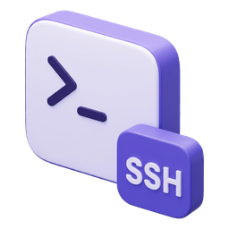

# pssh-ui

[](https://github.com/eduardomozart/pssh-ui/releases/latest)

Multiplatform desktop application for parallel SSH configuration and audit automation across managed network switches.

## Key Features

### Device Inventory & AirWave Import
Manage switches manually with **+ Add Device** or connect directly to **Aruba AirWave** via **Import from AirWave...** to browse the folder hierarchy, filter switches by name, IP, OS type, group, or status, and keep track of your active switch inventory.


### Reusable Command Snippets
Organize **Config** and **Audit and Remediate** command templates by switch OS, preview syntax-highlighted CLI scripts, import/export XML snippets, and customize commands before execution.


### Device Automation Profiles
Pre-configured **Device Models** (`ArubaOS-CX`, `ArubaOS-S (ProCurve)`, and custom models) handle login prompts, privilege escalation (`enable`), paging suppression, and configuration wrappers (`configure terminal` / `end`) automatically.


### Guided Task Creation Wizard
Run configuration or audit tasks across multiple switches through an intuitive step-by-step wizard:

1. **Config Command** — Pick **Config** or **Audit and Remediate**, set the task name, choose the target OS and device model, select a snippet, and adjust CLI commands as needed.

   

2. **Parameters** — Automatically prompted whenever a snippet uses interactive variables, with real-time input validation (`✓`).

   

3. **Select Device** — Filter by device, IP, OS type, group, or live ping status and check the target switches.

   

4. **Confirm & Run** — Enter SSH/Enable credentials, choose parallel or sequential execution, optionally run `write memory`, review the exact commands to be sent, and click **Run Job**.

   

## Quick Start

```bash
pip install -r requirements.txt
python main.py
```

Prebuilt Windows binaries are available on the **[Releases](https://github.com/eduardomozart/pssh-ui/releases/latest)** page.

## Running Tests

```bash
pip install -r requirements-dev.txt
python -m pytest tests/ -v
```

## Documentation & Translations

Full guides and technical architecture details are available in the **[Wiki (`docs/`)](docs/Home.md)**:
- **[User Guide](docs/User-Guide.md)** — Detailed workflow, settings, and log inspection
- **[Snippets & Variables](docs/Snippets-and-Variables.md)** — XML templates, parameterized inputs, and Audit RegEx rules
- **[Developer Design Choices](docs/Developer-Design-Choices.md)** — Architecture, SSH PTY automation, OS config paths, security, and release packaging
- **[Localization & Transifex](docs/Localization-and-Transifex.md)** — Multi-language `.po`/`.mo` catalog workflow

Help translate **`pssh-ui`** into more languages on **[Transifex](https://app.transifex.com/eduardomozart/pssh-ui/)**.
