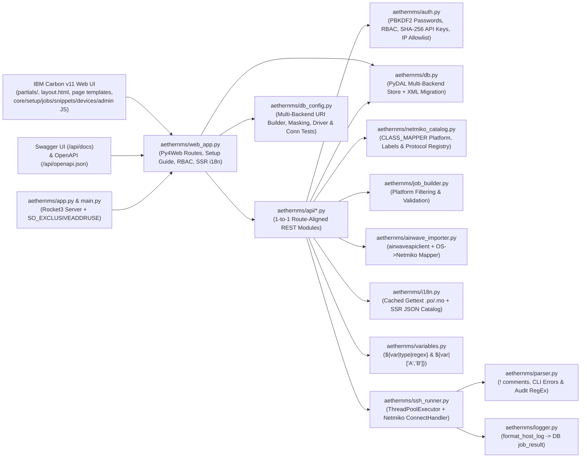

# Architecture & Design Choices

This document explains the architectural, security, and runtime design decisions behind **`aethernms`** (**ÆTHER NMS**).

## 1. High-Level Architecture

Core automation and domain modules (`db_config.py`, `db.py`, `netmiko_catalog.py`, `ssh_runner.py`, `parser.py`, `variables.py`, `job_builder.py`, `airwave_importer.py`, `ping_checker.py`) are decoupled from browser state, enabling deterministic WSGI and unit testing under `tests/`.

## 2. Runtime Storage & Windows MSIX Safety (`aethernms/paths.py`, `aethernms/app.py`)

* **Unified User Profile Directory (`~/.aethernms`)**: `get_config_dir()` resolves to `Path.home() / ".aethernms"` across Windows (`%USERPROFILE%\.aethernms`), Linux, and macOS unless overridden by `AETHERNMS_CONFIG_DIR`. Avoiding `%APPDATA%` prevents Microsoft Store Python MSIX filesystem virtualization (`LocalCache\Roaming`) from silently hiding `aethernms.db`, `.session_secret`, and `db_config.json` from the user.
* **Single-Listener Port Binding**: On Windows, Rocket3 sets `SO_REUSEADDR` which otherwise allows two processes to bind the same port simultaneously and hijack requests intermittently. `_ensure_port_available()` in `aethernms/app.py` probes with `SO_EXCLUSIVEADDRUSE` on Windows before Rocket3 startup and fails fast if the port is already occupied.

## 3. Uninitialized Setup Mode & Multi-Backend PyDAL (`aethernms/db_config.py`, `aethernms/db.py`)

* **No Premature `.db` Creation**: When started without `--db-path`, `--db-uri`, `AETHERNMS_DB_URI`, `db_config.json`, or an existing `aethernms.db`, `create_app()` initializes `AppContext(db=None)` without writing any SQLite file to disk. UI routes redirect (`302`) to `/setup`, while `/api/*` endpoints return HTTP `503` with `{"setup_required": true}`.
* **Multi-Backend PyDAL Adapters**: `db_config.py` defines structured support for `sqlite`, `postgres`, `mysql`, `mssql` (`mssql4://` with ODBC driver parameter), `oracle`, and `custom` raw PyDAL URIs. `DatabaseStore` passes `decode_credentials=True`, keeps PyDAL `.table` metadata files in `<runtime_root>/dal_meta` for non-SQLite databases, and restricts SQLite-only `adapter_args={"timeout": 15.0}` and `PRAGMA` statements behind `if self.is_sqlite:`.
* **Live Hot-Swap & Lazy Reload**: `POST /setup` validates Admin inputs, initializes and migrates the chosen PyDAL backend, seeds read-only RBAC system roles and read-only built-in snippets, saves `db_config.json` (`0o600` on POSIX), hot-swaps `ctx.db` live without restart, signs the Admin into `aethernms_session`, and locks out `/setup*` routes (`302`/`403`). `_ensure_db_loaded(ctx)` lazy-reloads `db_config.json` if `ctx.db` is still `None` across processes.
* **Credential Masking & Password Security**: `mask_dal_uri()` redacts URI and ODBC secrets (`PWD=`, `password=`, `passwd=`) before logs, UI display, or `GET /api/settings`. Device SSH/Telnet passwords, enable passwords, AirWave passwords, and `${var|password}` parameter values are never stored in plaintext.

## 4. RBAC, External API Gate & Read-Only System Defaults (`aethernms/auth.py`, `aethernms/api/`)

* **Dual Auth Separation**: Browser interactions (`/login`, `/logout`, `/account/password`, plus `/api/*` from active browser sessions) use signed Py4Web `Session` cookies (`aethernms_session`, backed by `.session_secret`). Username matching in `create_user` and `authenticate_user` is case-insensitive (`LOWER(username)`). External REST clients and Swagger UI (`request.credentials = "omit"`) authenticate exclusively via `X-API-Key` or `Authorization: Bearer aethernms_...`, gated by `api_enabled` (`False` by default) and `api_allowed_ips` (`127.0.0.1, ::1` default).
* **Read-Only System Entities**: Built-in roles (`Admin`, `Operator`, `Viewer` with `is_system=True`) and bundled Netmiko snippets (`is_builtin=True`) cannot be edited or deleted (`ValueError` in `db.py`, HTTP `403` in REST APIs). Users clone built-in templates to customize commands.
* **Granular Permissions**: `jobs:read`, `jobs:run`, `jobs:delete`, `snippets:read`, `snippets:write`, `devices:read`, `devices:write`, `airwave:import`, `system:settings`, `users:manage`, `roles:manage`, `api_keys:manage`.

## 5. Platform Labels & Assets

* **Friendly Netmiko Platform Labels (`aethernms/netmiko_catalog.py`)**: Raw Netmiko keys (e.g., `aruba_procurve`, `aruba_aoscx`) remain canonical in the DB and REST payloads (`platform`), while `platform_display_name()` and `get_platform_labels()` map them to friendly display names (e.g., `ArubaOS-S`, `ArubaOS-CX`) for UI dropdowns, tables, and device selectors.
* **SVG Brand & App Icons (`assets/`, `scripts/generate_assets.py`)**: Generated offline from `aethernms.svg`: multi-resolution `favicon.ico`, 180×180 `apple-touch-icon.png` (iOS Home Screen web app support), `icon-192.png`, `icon-512.png`, and `site.webmanifest`, served at `/assets/*` and included via `partials/head_icons.html`.
