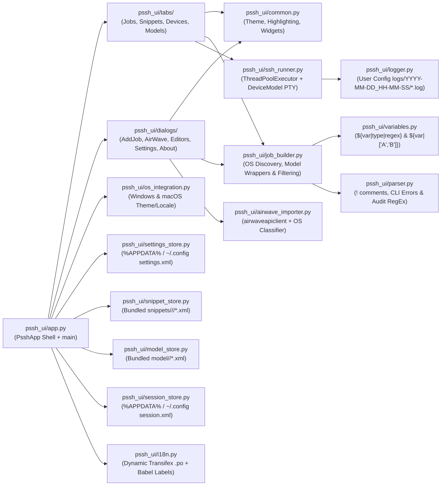

# Developer Design Choices

This document explains the architectural and technical choices behind **`pssh-ui`**.

---

## 1. High-Level Architecture

Core logic lives in pure Python modules decoupled from `tkinter`, allowing automated unit testing without requiring a desktop display. Interface modules live in `pssh_ui/app.py`, `pssh_ui/common.py`, `pssh_ui/tabs/`, and `pssh_ui/dialogs/`.

---

## 2. User Data vs Distributed Templates (`pssh_ui/paths.py`)

* **Per-User Directory** (`%APPDATA%\pssh-ui` on Windows; `~/.config/pssh-ui` or `$XDG_CONFIG_HOME/pssh-ui` on Linux/macOS): stores `settings.xml`, `session.xml`, and `logs/`, created automatically when missing. In frozen `.exe` builds, editable `snippets/` and `model/` XML libraries are also seeded here from `_MEIPASS` defaults (`seed_bundled_templates()`) via SHA-256 hash tracking (`.seed_manifest.json`) so unedited defaults auto-update on upgrade, deletions are preserved, and user customizations never get overwritten (`<file>.xml.new` sidecars preserve upstream changes).
* **Source Mode Templates**: Running directly from source resolves `snippets/` and `model/` to the repository root cleanly.
* **Zero-Code XML & Catalog Extensibility**: `parse_device_type()` (`CustomOS`) and `discover_device_types()` load any `<DeviceType>` defined in `model/<vendor>/*.xml` or `snippets/<vendor>/<os>/*.xml` dynamically without hardcoding OS enums in Python source code (`<Folder>` tags are omitted because subfolder hierarchy derives from directory layout). Dropping a Transifex `.po` file under `locales/<lang>/LC_MESSAGES/` likewise enables a new language automatically via `gettext`/Babel.

---

## 3. Visual Design, Settings & About (`Sun-Valley-ttk-theme`)

* **OS Auto Defaults**: Both Theme and Language default to `"auto"` (**Auto (OS Default)**) on Windows and macOS (`pssh_ui/os_integration.py`). Global settings live in `settings.xml` (accessible via **`⚙`**; integer validation blocks decimal timeouts).
* **Header & About**: Displays the transparent PNG app icon generated in `assets/` (plus a 9-resolution DIB/PNG `.ico`), the `"Config & Audit Automation"` subtitle, an **`ⓘ`** dialog (`pssh_ui/dialogs/about_dialog.py`) showing app metadata + clickable Git URL (`get_repository_url()` parsing `.git/config`), and **`⚙`** (`pssh_ui/dialogs/settings_dialog.py`).
* **Dynamic Step Wizard**: Step headers render Pillow-supersampled circular badges (`1`–`3` when a template has no variables, expanding dynamically to `1`–`4` with **Parameters** when `${...}` variables exist) using Sun-Valley accent blue (`#0067c0` / `#60cdff`). Switching `Job Type *` (`Config` ↔ `Audit and Remediate`) filters `Snippets *`, closes any open popdown, and resets selection cleanly.
* **Parameterized Templates (`pssh_ui/variables.py`)**: Supports `${var|type|regex}` and `${var|["Item 1", "Item 2"]}` syntax with uppercase letters, spaces, accents, HTML-like field types (`text`, `password`, `number`, `email`, `url`, `select`), regex validation, and `!` comments.
* **Row-Level Actions, Import/Export & `Job Details`**: **Jobs**, **Snippets** (**Import/Export Snippet**), **Devices**, and **Device Models** (**Import/Export Device Model**) expose inline row icons; **Job Details** highlights **bold** counts, borderless surfaces, and per-row log viewing.

---

## 4. `DeviceModel` Automation & Paramiko PTY (`pssh_ui/ssh_runner.py`)

`ArubaSSHClient` uses an interactive PTY (`invoke_shell(term="vt100")`) driven by the selected `DeviceModel`:
1. Matches `PagerPromptRegex` / `Press any key to continue` and issues `DisablePagingCommand` (`no page`).
2. Detects `UsernamePromptRegex`, `PasswordPromptRegex`, and `EnablePasswordPromptRegex` so credential prompts or privilege escalation (`EnableCommand = enable`) work automatically when switches challenge the automation session.
3. `wrap_commands_with_model()` prepends `PreConfigCommands` (`configure terminal`) and appends `PostConfigCommands` (`end`) — plus `WriteCommand` (`write memory`) when checked in Step 4 — only for `Config` jobs, eliminating duplicate `configure terminal` boilerplate in XML snippets while avoiding duplicate boundary commands.
4. `validate_audit_regex()` verifies every active RegEx line from `<AuditRegex>` against combined switch output after execution.

---

## 5. Security, Logging & Release Automation

* **Timestamped Per-Switch Logs & Password-Free Disk State**: Writes per-switch transcripts to `%APPDATA%\pssh-ui\logs\YYYY-MM-DD_HH-MM-SS\<hostname-or-switch-ip>.log` (or `~/.config/pssh-ui/logs/...`). `settings_store.py` and `session_store.py` never persist SSH, Enable, AirWave, or `|password|` variable values to disk.
* **PyInstaller & Release Workflow**: `.github/workflows/release.yml` bundles `--icon assets/pssh-ui.ico`, `assets/`, `snippets/`, `model/`, `locales/`, and `sv_ttk` into `pssh-ui-x64.exe`, injecting release tag & GitHub repository metadata automatically.
