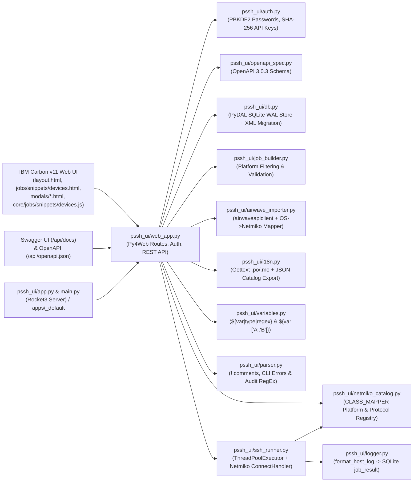

# Developer Design Choices

This document explains the architectural and technical choices behind **`pssh-ui`**.

---

## 1. High-Level Architecture

Core automation and domain modules (`netmiko_catalog.py`, `ssh_runner.py`, `parser.py`, `variables.py`, `job_builder.py`, `airwave_importer.py`, `ping_checker.py`, `db.py`) are pure Python modules completely decoupled from the browser UI, enabling fast deterministic WSGI and unit testing with mocked Netmiko connections.

---

## 2. Py4Web + PyDAL SQLite Persistence (`pssh_ui/db.py`)

* **Single SQLite Database (`WAL` Mode)**: Stored at `%APPDATA%\pssh-ui\pssh_ui.db` (Windows) or `~/.pssh-ui/pssh_ui.db` (Linux/macOS), containing `auth_user`, `api_key`, `app_settings`, `snippet`, `device`, `saved_parameter`, `job`, and `job_result` (including `formatted_log` per device).
* **Thread-Safe Short-Lived PyDAL Connections**: Because background Netmiko `ThreadPoolExecutor` workers update per-host statuses concurrently while the browser polls `/api/jobs`, `DatabaseStore` serializes short-lived PyDAL WAL connections under an `RLock` with `PRAGMA busy_timeout=15000` and `PRAGMA foreign_keys=ON`.
* **SHA-256 Bundled Snippet Seeding**: Built-in XML templates under `snippets/<vendor>/<platform>/*.xml` are seeded into the `snippet` table on startup. Unedited bundled rows auto-update when upstream XML hashes change, user deletions set `is_deleted=True` (respected across restarts), and user edits clear `seeded_sha256` so customizations are never overwritten.
* **One-Time Legacy XML Migration**: On first launch against an empty database, `migrate_legacy_xml_files()` imports legacy `settings.xml`, `devices.xml`, `jobs.xml` (or `session.xml`), and any existing disk `.log` files into SQLite automatically while scrubbing `|password|` variable values.

---

## 3. Authentication, API Keys & OpenAPI 3.0.3 (`pssh_ui/auth.py`, `pssh_ui/openapi_spec.py`)

* **Session + API Key Dual Auth**: Browser sessions use signed Py4Web `Session` cookies (`pssh_ui_session`, backed by a persistent high-entropy `.session_secret` meeting Py4Web's `IS_STRONG(entropy=50)` check). REST API automation clients authenticate with `X-API-Key: pssh_...` or `Authorization: Bearer pssh_...` headers validated against SHA-256 key digests in `api_key`.
* **Self-Documenting REST API**: Every GUI action maps 1-to-1 to a `/api/...` JSON route documented in `pssh_ui/openapi_spec.py` (OpenAPI 3.0.3 at `/api/openapi.json`) and rendered via `/api/docs` (`/swagger`), including an offline built-in OpenAPI explorer fallback when external CDNs are unavailable in air-gapped networks.

---

## 4. IBM Carbon Design System v11 & AirWave Workflow

* **Zero-Build Self-Contained Carbon v11 UI**: `pssh_ui/static/css/carbon-v11.css` implements official IBM Carbon v11 design tokens (`g10` Light and `g100` Dark), UI Shell Header, Tabs, DataTable, Pagination, Tags, Progress Indicator, Modals, and syntax-highlighted CLI code blocks with zero Node.js/npm build dependency.
* **AirWave Empty-Until-Fetch & Read-Only Separation**: The **Import from AirWave** modal stays empty until credentials are provided and **Fetch Inventory** runs. For imported AirWave devices (`is_airwave_host()`), both the UI and backend (`PUT /api/devices/{id}` + `DatabaseStore.update_device()`) enforce read-only identity/inventory fields (**Name**, **IP Address**, **Model**, **Group**) while keeping **Netmiko Platform**, **Protocol**, and **Port** editable.
* **Dynamic Step Wizard**: The Carbon Progress Indicator dynamically shows `1–3` steps when a snippet has no variables and expands to `1–4` steps (`Parameters`) when `${...}` variables are present. Pressing `Esc` closes the topmost open modal cleanly.

---

## 5. Native Netmiko Automation Engine (`pssh_ui/ssh_runner.py`)

`PSSHClient` delegates session negotiation, banner handling, paging suppression (`disable_paging`), privilege escalation (`enable()`), configuration mode transitions (`config_mode()` / `exit_config_mode()`), and config saving (`save_config()`) directly to **Netmiko** native drivers via `ConnectHandler`:
1. `resolve_netmiko_device_type(platform, protocol)` maps `(host.os_type, host.protocol)` exclusively to native keys registered in Netmiko `CLASS_MAPPER` (rejecting unsupported Telnet combinations without synthetic fallbacks).
2. Raw wire transcripts are captured natively via an in-memory `io.BytesIO` buffer passed to Netmiko `session_log` (with Netmiko's built-in secret filtering masking login and enable passwords), cleaned with `clean_terminal_text()`, formatted via `format_host_log()`, and persisted directly in SQLite `job_result.formatted_log`.
3. **Config** jobs enter config mode natively and execute each rendered CLI command step-by-step via `send_config_set([cmd], enter_config_mode=False, exit_config_mode=False, error_pattern=CONFIG_ERROR_PATTERN)` to stop immediately on the first CLI error; **Audit and Remediate** jobs run commands via `send_command()` and evaluate `audit_regex` rules with `validate_audit_regex()`.

---

## 6. Security & Release Automation

* **Zero Plaintext Device/Template Secrets in SQLite**: Device SSH/Telnet passwords, enable passwords, AirWave passwords, and `${var|password}` parameter values are never stored in SQLite (masked as `••••••••` in `parameters_masked_json` and `********` in `commands_rendered`). User account passwords use salted PBKDF2-HMAC-SHA256 (`600,000` iterations); API keys store only SHA-256 digests.
* **PyInstaller Portable ZIP Release Workflow**: `.github/workflows/release.yml` builds with PyInstaller `--onedir` (`--icon assets/pssh-ui.ico`, collecting `py4web`, `pydal`, `yatl`, `ombott`, `renoir`, `rocket3`, `netmiko`, and bundling `pssh_ui/templates`, `pssh_ui/static`, `snippets`, `locales`, `assets`), copies `LICENSE`, `README.md`, `CHANGELOG.md`, and `wiki/` alongside `pssh-ui-x64.exe` and `_internal/`, and packages everything into `pssh-ui-win-x64.zip`.
